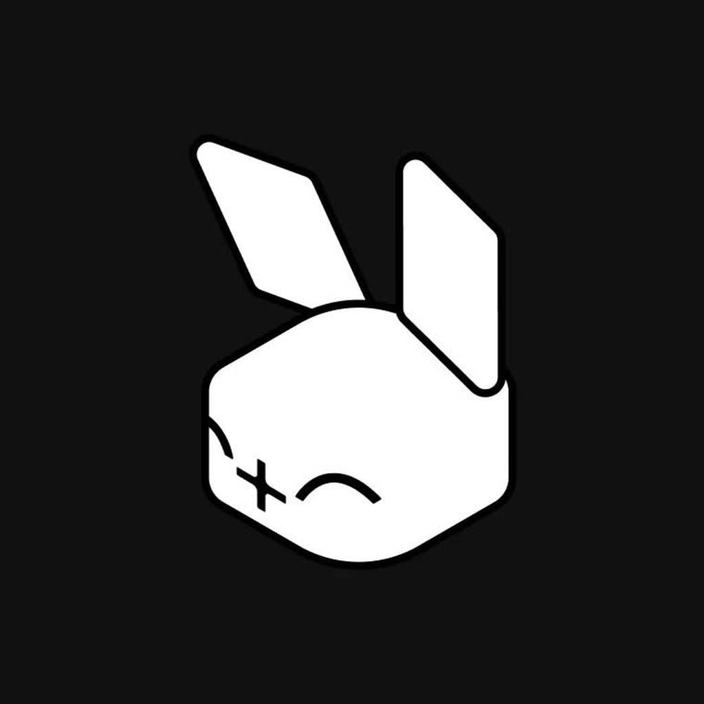

<p align="center">
  
</p>

<h1 align="center">rally.</h1>

<p align="center">
  <strong>Find players, build your gamer ID, play together.</strong><br />
  The gamer-network mobile app · Flutter · Android first
</p>

<p align="center">
  
  
  
</p>

---

## What it is

Rally helps gamers in Addis Ababa find people to play with. You post a
listing ("duo for ranked tonight, voice required"), other players ask to
join, and once you accept a request you can see each other's gaming IDs.

The app runs on `apps/api` through a client generated from
`packages/api-spec/openapi.json`. The screens keep the prototype's look;
what the MVP leaves out (the Home feed, posts, groups) is gone
([ADR-0001](../../docs/decisions/0001-mvp-is-find-players-only.md)).

> Owner: Natnael Sisay ([@Natnsis](https://github.com/Natnsis)). Scope lives in
> [`docs/PRD.md`](../../docs/PRD.md), and decisions live in
> [`docs/decisions/`](../../docs/decisions/).

## Features

| | |
| --- | --- |
| 🎮 **Gamer ID** | Pick your games, set a rank or level per game, and choose your platforms (PC, PlayStation, Xbox, Switch, Mobile). |
| 🔎 **Find Players** | Browse open listings, or post your own with game, mode, squad size, voice, time and duration. Listings expire. |
| 🤝 **Connections** | Request to join, and the owner accepts. Gaming IDs unlock only after acceptance. |
| 🎯 **Play together** | Invite a connection to play now, in 30 minutes or tonight; the next day, “Did you play?” in one tap. |
| 🏠 **Home** | Your status and play days, your live listing, invites, check-ins and who's looking right now. |
| 👥 **Groups** | "Coming soon" with a waitlist. |
| 🔔 **Alerts** | Connection requests and activity in one place. |
| 🖼️ **Profile** | Photo, bio, games and ranks, play style and gaming IDs, edited in place. |
| 🛡️ **Safety** | Block and report on every profile and listing, Blocked users and Delete account in Settings. |
| 🕹️ **49 games** | From Valorant and CS2 to PUBG Mobile, CoD Mobile, eFootball, MLBB and Free Fire, each with its rank ladder, from the API. |

## Four skins

The whole UI can be reskinned at runtime. Colours and shadows blend
between skins, and your choice is saved with `shared_preferences`.

| Skin | Feel | Type |
| --- | --- | --- |
| **Inked** | Hard shadows, segment digits | Outfit · DSEG7 |
| **Soft clay** | Pillowy, mint on stone | Plus Jakarta Sans · Manrope |
| **Dot matrix** | Matte black, signal red | Doto · Space Mono · Silkscreen |
| **Glass** | Frosted panels, aurora glow | Space Grotesk |

## Getting started

Run the API locally first ([apps/api](../api/README.md)), then:

```bash
cd apps/mobile
flutter pub get
flutter run            # emulator: talks to http://10.0.2.2:3300 (the host's API)
flutter test           # widget tests, against an in-memory fake API
```

On a phone, or to use `adb reverse` instead of `10.0.2.2`, pass the API's
address: `flutter run --dart-define=API_URL=http://localhost:3300` after
`adb reverse tcp:3300 tcp:3300` (and `tcp:9470` for avatar uploads to the
local storage). Debug builds allow plain `http`; release builds don't.

Locally the API prints email codes to its console instead of sending
them, so sign-up and password reset read the code from there.

The API client in `packages/api_client` is generated; never edit it. When
`packages/api-spec/openapi.json` changes on `dev`:

```bash
tool/generate_api_client.sh   # needs Java 11+ and Node
```

The end-to-end test drives the app on an emulator against a local API:
see [integration_test/README.md](integration_test/README.md).

Regenerate launcher icons after changing `assets/icon/`:

```bash
dart run flutter_launcher_icons
```

## Project layout

```
lib/
├── main.dart          # app entry, theme persistence, the Api
├── api.dart           # Dio + generated client: token, version headers, errors
├── state.dart         # AppState: navigation, drafts, every API call
├── data.dart          # game catalog, labels for the API's enums, Profile
├── shell.dart         # screen switcher, header, bottom nav, sheets
├── theme.dart         # RallyTheme + the four skins
├── widgets.dart       # shared UI kit (Pill, cards, backgrounds…)
└── screens/
    ├── onboarding.dart     # intro, log in, sign-up, email code, reset, game/rank/platform steps
    ├── games.dart          # game picker and rank cards
    ├── home.dart           # status, live listing, invites, check-ins
    ├── find.dart           # Find Players, Alerts, search
    ├── groups.dart         # coming soon + waitlist
    ├── profile.dart        # player profile, settings
    ├── edit_profile.dart
    └── safety.dart         # block, report, blocked users, delete account
packages/api_client/   # generated from the spec (tool/generate_api_client.sh)
integration_test/      # end to end against a local API
assets/
├── fonts/   # bundled typefaces for the skins
├── icon/    # launcher icon sources
└── logo/    # fill + line marks
```

## Not wired yet

- **Push notifications (FCM).** Needs a Firebase project and
  `google-services.json`; until then Alerts refresh when opened, and Home
  checks the badge and invites every 30 seconds.
- **Google sign-in.** Needs `GOOGLE_CLIENT_IDS` on the API and the Android
  OAuth client; email + password works.
- **Deep links.** `https://<domain>/l/<id>` opening the app (Android App
  Links) comes with the domain.
- **Naming.** The Dart package is still `rally`. The final product name is
  open (see the PRD).
